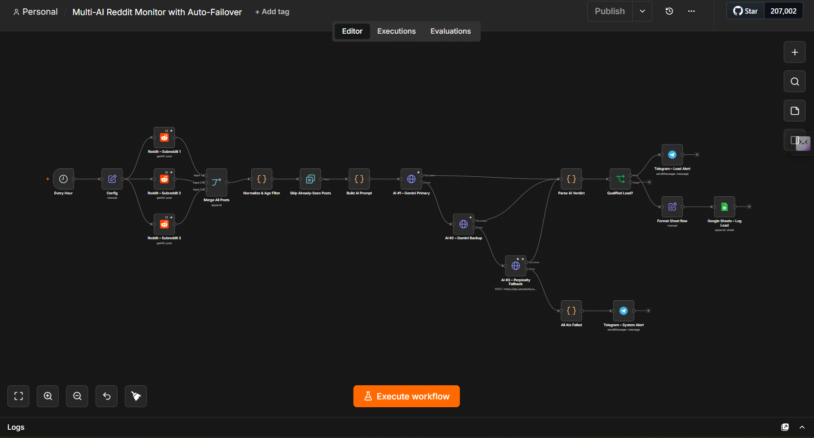

# Multi-AI Reddit Monitor with Auto-Failover (n8n)



An n8n workflow that watches 3 subreddits 24/7, uses AI to judge each new post by **context and intent** (not keywords), sends qualified leads to **Telegram**, logs them to **Google Sheets**, and automatically fails over between **Gemini → Gemini → Perplexity** when a model hits a quota or rate limit.

---

## How it works

```
Every Hour → Config ─┬─ Reddit r/sub1 ─┐
                     ├─ Reddit r/sub2 ─┼─ Merge → Normalize & Age Filter → Skip Already-Seen → Build AI Prompt
                     └─ Reddit r/sub3 ─┘                                                         │
                                                                                                 ▼
                                    ┌──────────── success ──────────── AI #1 Gemini Primary (key 1)
                                    │                                     │ error (429 / quota / timeout)
                                    ├──────────── success ──────────── AI #2 Gemini Backup (key 2)
                                    │                                     │ error
                                    ├──────────── success ──────────── AI #3 Perplexity Sonar (2 retries)
                                    ▼                                     │ error
                            Parse AI Verdict                      All AIs Failed → Telegram system alert
                                    ▼
                            Qualified Lead?  (is_relevant AND score ≥ min_score)
                                    ├─→ Telegram lead alert
                                    └─→ Format Sheet Row → Google Sheets
```

**Key design points**

- **Failover is per post.** Each AI node uses *On Error → Continue (using error output)*, so if Gemini Primary fails on post #12, only that post moves to the backup — everything else keeps flowing.
- **Two separate Gemini keys** from two different Google Cloud projects means two independent free-tier quotas.
- **No duplicate alerts.** The *Remove Duplicates* node remembers post IDs across executions, so each post is analysed (and costs tokens) exactly once.
- **Rate-limit friendly.** AI requests are batched one at a time, 6 seconds apart.
- **Transparency.** The `AI Provider` column shows which model handled each lead — great for proving the failover works.

---

## 1. Import the workflow

n8n → **Workflows → Import from File** → choose [`reddit-multi-ai-monitor.json`](reddit-multi-ai-monitor.json).

## 2. Create credentials

On a self-hosted instance, the OAuth redirect URL for Reddit and Google is:
`https://<your-n8n-domain>/rest/oauth2-credential/callback` (n8n shows the exact URL on the credential screen — copy it from there).

| Credential | Type in n8n | How to get it |
|---|---|---|
| **Reddit** | Reddit OAuth2 API | reddit.com/prefs/apps → *create app* → type **web app** → paste n8n's redirect URL → copy client ID (under the app name) & secret. Review Reddit's Data API terms if you use it commercially. |
| **Gemini Key 1** | Header Auth — Name: `x-goog-api-key`, Value: your key | aistudio.google.com → *Get API key* → create in **Project A** |
| **Gemini Key 2** | Header Auth — Name: `x-goog-api-key`, Value: your key | Same, but create a **new Project B** so it has its own quota |
| **Perplexity** | Header Auth — Name: `Authorization`, Value: `Bearer pplx-xxxx` | perplexity.ai → Settings → API (requires credits) |
| **Telegram** | Telegram API | Message **@BotFather** → `/newbot` → copy token |
| **Google Sheets** | Google Sheets OAuth2 API | Google Cloud Console → enable Sheets API → OAuth client (Web) with n8n's redirect URL |

Then open each node and select its credential:

- 3 × Reddit nodes → Reddit
- `AI #1 – Gemini Primary` → Gemini Key 1
- `AI #2 – Gemini Backup` → Gemini Key 2
- `AI #3 – Perplexity Fallback` → Perplexity
- 2 × Telegram nodes → Telegram
- `Google Sheets – Log Lead` → Google Sheets

## 3. Prepare the Google Sheet

Create a sheet with a tab named **Leads** and paste this header row into row 1:

```
Timestamp	Subreddit	Title	Author	Post URL	Lead Score	Category	Reason	Suggested Reply	AI Provider	Posted At	Post ID
```

Copy the Sheet ID from its URL: `docs.google.com/spreadsheets/d/`**`THIS_PART`**`/edit`

## 4. Get your Telegram chat ID

Send any message to your new bot, then open
`https://api.telegram.org/bot<YOUR_TOKEN>/getUpdates` and copy `result[0].message.chat.id`.
(For a group: add the bot to the group, post a message, and use the negative ID.)

## 5. Edit the Config node — the only node you need to change

| Field | Default | Meaning |
|---|---|---|
| `subreddit_1/2/3` | n8n, automation, forhire | Names without `r/` |
| `posts_per_subreddit` | 25 | Newest posts fetched per run |
| `lookback_hours` | 24 | Ignore posts older than this |
| `min_score` | 7 | Minimum AI score (0–10) to alert |
| `lead_criteria` | Hiring for automation work | Plain-English description of a good lead — this is the main thing to tune |
| `telegram_chat_id` | — | From step 4 |
| `google_sheet_id` | — | From step 3 |
| `sheet_tab_name` | Leads | Tab name |
| `gemini_primary_model` | gemini-2.5-flash | Change if Google renames models |
| `gemini_backup_model` | gemini-2.5-flash-lite | |
| `perplexity_model` | sonar | |

## 6. Test, then activate

1. Click **Execute Workflow** and check each node's output.
2. **Demo the failover** (great for a portfolio video): put a wrong value in Gemini Key 1 → run → posts flow to Gemini Backup and the sheet shows `AI Provider = Gemini Backup`. Break Key 2 as well → Perplexity takes over. Break all three → you get the ⚠️ Telegram system alert.
3. Restore the keys and toggle the workflow **Active**.

> Tip: while testing, the *Skip Already-Seen Posts* node will drop posts you've already processed. To re-test the same posts, open that node and use **Clear deduplication history**.

---

## Customising

- **Different niche:** just rewrite `lead_criteria` (e.g. "Indie studios looking to hire a Unity developer").
- **More subreddits:** duplicate a Reddit node, connect it to the Merge node and raise *Number of Inputs*.
- **Run frequency:** change the *Every Hour* trigger. Keep `lookback_hours` larger than the interval.
- **Log everything, not just leads:** connect the IF node's *false* output to another Sheets node with a separate tab.

## Known limits

- Gemini free-tier rate limits change from time to time; if you see frequent failovers, increase the batch interval on the AI nodes.
- If all three AIs fail for a post, it's still marked as seen — the system alert includes the link so you can check it by hand.

---

## Portfolio description (ready to paste)

**Multi-AI Reddit Monitor with Auto-Failover (n8n)**
A production-style n8n automation that monitors three subreddits around the clock and uses AI to read each new post in context, scoring how closely it matches a client's ideal lead. Qualified leads are pushed instantly to Telegram with a suggested reply and logged to Google Sheets. A per-post failover chain (Gemini → second Gemini key → Perplexity) keeps the system running through rate limits and quota outages, with a Telegram alert only if every provider is down. Built-in deduplication means each post is processed once, keeping AI costs minimal.

**Stack:** n8n · Reddit API · Google Gemini API · Perplexity API · Telegram Bot API · Google Sheets
